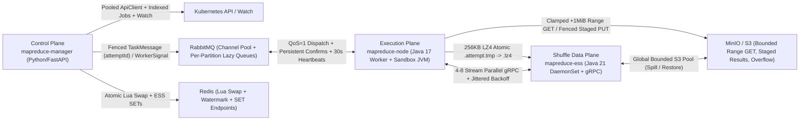

# Kubernetes MapReduce Framework (K8s-MapReduce)

A cloud-native, high-throughput, fault-tolerant distributed MapReduce framework built for Kubernetes.

This monorepo contains the complete infrastructure, control plane, execution engine, and shuffle data plane required to schedule, isolate, and execute parallel batch data processing workloads across Kubernetes clusters. It implements Active-Active state reconciliation, Ephemeral JVM Sandboxing, Multi-Pass External Merge Sorting, Monotonic Attempt Fencing, and Decentralized Peer-to-Peer (P2P) gRPC Shuffling with Bounded Admission Control and MinIO Overflow Tiering.

---

## 🏗️ System Architecture & Monorepo Structure

The framework is decoupled into three primary planes. Each directory contains its own detailed `README.md`:



### 1. [`/mapreduce-manager`](./mapreduce-manager/) (The Control Plane)

The central Orchestrator built in **Python (FastAPI)** operating in Active-Active mode backed by PostgreSQL, Redis, and RabbitMQ:

* **`Indexed` Kubernetes Reduce Jobs & Per-Partition Queues (`ADR-04`):** Spawns **1** `BatchV1` Job (`completionMode: Indexed`, `completions=R`, `parallelism=R`, `backoffLimitPerIndex=3`, `restartPolicy: Never`) for normal Reduce phases over deterministic `reduce_tasks_<jobId>_<pId>` lazy queues, retaining single-partition Jobs (`PARTITION_ID`) with soft `nodeAffinity` strictly for targeted lineage recovery.
* **Atomic Phase Capacity Swap & `O(1)` Splits (`ADR-05`):** Uses an atomic Redis Lua `swap_map_to_reduce_capacity` script and `cluster:reduce_waiting` watermark so incoming Map submissions never starve transitioning Reducers, plus `O(1)` byte-offset math (`get_chunk_split`) for single-chunk recovery.
* **Monotonic Attempt Fencing & Staged S3 Promotion (`ADR-06`):** Mints monotonic `attempt_id`s (`HINCRBY job:{id}:attempts task_id 1`), drops stale zombie `WorkerSignal`s, and promotes the winning Reduce attempt's staged S3 object (`_attempts/part_<p>_attempt_<aId>.staging` -> `result_part_<p>.txt`) before advancing barriers.
* **Pooled K8s `ApiClient`, Async `Job` Watch & Batched Reconciler (`ADR-11`):** Shares one lifecycle-managed `kubernetes_asyncio.client.ApiClient`, replaces `5s` completion polling with an async `Watch` stream (`resourceVersion` tracking + `410 Gone` relist), and batches `reconciler.py` sweeps into one `list_namespaced_pod(label_selector="app=worker-node")` call.
* **Redis `SET` Endpoint Discovery & Reverse Index (`ADR-12`):** Tracks unique ESS nodes in `SET job:{id}:ess_nodes` (`O(K)`) and per-node task lineage in `SET job:{id}:node_tasks:{ip:port}` (`O(M/K)`), with dead-ESS eviction on node shuffle failure.
* **AMQP Channel Isolation & Publisher Pool (`ADR-13`):** Isolates `job_events_queue` and `orchestration_events_queue` onto dedicated consumer channels and backs publisher/RPC operations with a bounded `8`-channel `asyncio.Queue` pool with automatic closed-channel replacement.

### 2. [`/mapreduce-node`](./mapreduce-node/) (The Execution Plane)

The stateless compute worker built in **Java 17**, pairing a lightweight C1-compiled `App` coordinator JVM with an isolated `SandboxRunner` child JVM per task:

* **Bounded Parallel gRPC Shuffle Fetch & Jittered Backoff (`ADR-01`):** Fetches upstream partitions concurrently across `4–8` bounded streams (`REDUCE_FETCH_CONCURRENCY`, default `8`), reusing persistent `ManagedChannel`s per ESS endpoint, retrying `RESOURCE_EXHAUSTED` / `UNAVAILABLE` with full-jitter exponential backoff (`200ms` base, `10s` cap), and cancelling sibling futures fast on terminal errors (`FAILED_PRECONDITION`, etc.).
* **Multi-Pass `K=64` External Merge & Heap-Accurate Spill Accounting (`ADR-03`):** Caps open merge file descriptors at `K=64` (`MAX_MERGE_FAN_IN`) via multi-pass LZ4 intermediate merges (eagerly unlinking consumed runs per pass) and accounts for JVM object headers/UTF-16 arrays (`96 + 2 * (key.length() + value.length())` bytes) when spilling sorted runs.
* **Deterministic Index Binding, Persistent AMQP & `30s` Heartbeats (`ADR-04`, `ADR-06`):** Binds `PARTITION_ID` / `JOB_COMPLETION_INDEX` to `reduce_tasks_<jobId>_<idx>` (exiting immediately upon ACK without waiting for idle timeout), maintains a persistent auto-recovering AMQP connection + publisher-confirmed channel (`confirmSelect`), emits `IN_PROGRESS` heartbeats every `30s`, and fences Map/Reduce outputs by `attemptId`.
* **Bounded S3 Range Reads & `SIZE_256KB` LZ4 Framing (`ADR-08`, `ADR-09`):** Bounds `GetObjectArgs` with `.length(fetchLength + 1 MiB)` clamped to object size (preserving OkHttp keep-alive pooling, with continuation range GETs for `>1 MiB` straddling lines) and streams `BLOCKSIZE.SIZE_256KB` LZ4 frames over `64KB` buffers (`16x` lower compression buffer footprint).
* **Ordered `SIGTERM` Child-JVM Drain (`ADR-14`):** Flips `/health` to `503`, `basicCancel`s deliveries, drains active tasks up to `20s`, escalates `destroy()` -> `5s` -> `destroyForcibly()`, cleans task/attempt-scoped `.tmp` files, and issues `basicNack(requeue=true)` before closing AMQP.
* Includes **`mapreduce-core`**, exposing `Mapper`, `Reducer`, `Combiner`, `Context`, `KeyValuePair`, and `TaskPayload`.

### 3. [`/mapreduce-ess`](./mapreduce-ess/) (The Shuffle Data Plane)

The **External Shuffle Service** built in **Java 21** and deployed as a Kubernetes `DaemonSet` (`hostNetwork: true`, port `7337`):

* **Bounded Stream Admission & Global S3 Transfer Pool (`ADR-02`):** Gates active `getPartition` streams with a fair semaphore (`ESS_MAX_LOCAL_STREAMS=64`, timed `tryAcquire` returning `Status.RESOURCE_EXHAUSTED` on saturation) and routes all parallel `spillJobData` uploads and single-flight `restorePartition` downloads through one global bounded pool (`ESS_MAX_S3_CONCURRENCY=32`).
* **Pooled Direct `ByteBuffer` Streaming (`ADR-10`):** Leases one reusable `65,000`-byte NIO Direct `ByteBuffer` per active `getPartition` stream across all `.lz4` segments in a partition, returning it deterministically in `finally` on completion, cancellation, or `IOException`.
* **Graceful `SIGTERM` Drain & Fail-Loud Degraded S3 Mode (`ADR-14`, `ADR-15`):** Drains `streamingPool` (`<=20s`) after `server.shutdown()` and lets `StorageJanitor` finish any active spill/GC cycle cleanly (`<=15s`) before closing MinIO; returns `Status.FAILED_PRECONDITION` when `minioStorageService == null` and a requested partition is absent locally (reserving empty `OK` strictly for verified empty partitions).

---

## ⚙️ Key Operational Knobs & Observability

| Plane | Variable / Setting | Default | Purpose |
| --- | --- | --- | --- |
| Manager | `MAX_TOTAL_WORKERS` | `50` | Global Redis cluster slot ceiling shared across Map & Reduce phases |
| Manager | `RABBITMQ_CHANNEL_POOL_SIZE` | `8` | Bounded publisher/RPC AMQP channel pool size (`4–8`) |
| Manager | `RABBITMQ_ORCHESTRATION_PREFETCH` | `10` | Dedicated QoS prefetch on `orchestration_events_queue` |
| Node | `REDUCE_FETCH_CONCURRENCY` | `8` | Parallel gRPC shuffle streams per Reducer (clamped `4..8`) |
| Node | `GRPC_FETCH_DEADLINE_SECONDS` | `300` | Per-endpoint gRPC `getPartition` deadline |
| Node | `PARTITION_ID` / `JOB_COMPLETION_INDEX` | *(auto)* | Deterministic Reduce partition binding (`Indexed` K8s Job or targeted recovery) |
| ESS | `ESS_MAX_LOCAL_STREAMS` | `64` | Fair semaphore cap on concurrent `getPartition` streams (`RESOURCE_EXHAUSTED` on timeout) |
| ESS | `ESS_STREAM_ACQUIRE_TIMEOUT_MS` | `2000` | Max wait for an ESS local stream permit before fast rejection |
| ESS | `ESS_MAX_S3_CONCURRENCY` | `32` | Global bounded S3 pool shared across spill uploads and partition restores |

**Structured Correlation Logging:** All three planes emit JSON-structured logs correlated by `job_id`, `task_id` (or `partition_id` in ESS), `attempt_id`, and `phase`, keeping per-record and per-65KB-chunk hot loops strictly free of `INFO` logging.

---

## ⚡ Verified Minikube Cluster Benchmark (`T_before` vs. `T_after`)

Measured on the live single-node Minikube cluster (`30 GiB` RAM, `6` vCPUs, PostgreSQL + Redis + MinIO + RabbitMQ + 2x `manager-api` replicas + `external-shuffle-service` DaemonSet) using `mapreduce-manager/tests/e2e/benchmark_workload.py` (`0.25s` status polling, `10,000` distinct keys verified exact in MinIO `results`, `0` pod restarts, `0` `OOMKilled` pods, `0` leaked K8s Jobs or Redis permits):

| Workload / Metric | Pre-Refactor (`T_before`) | Post-Refactor (`T_after`) | Delta / Speedup |
| --- | --- | --- | --- |
| **Dataset (`benchmark_workload.py`)** | `283,220,000` B (`270.10 MiB`, `M=3`, `R=16`) | `283,220,000` B (`270.10 MiB`, `M=3`, `R=16`) | Identical workload |
| **Map Phase Wall-Clock (s)** | `26.592s` | `23.479s` | **`-3.113s` (`-11.7%`)** |
| **Shuffle / Reduce Phase Wall-Clock (s)** | `44.329s` | `31.200s` | **`-13.129s` (`-29.6%`)** |
| **Total Benchmark Wall-Clock (s)** | `70.920s` | **`54.678s`** | **`-16.242s` (`-22.9%` / `1.30x` faster)** |
| **Full Multi-Job E2E Suite (`pytest tests/e2e -v`)** | `91.41s` (2/2 passed) | **`36.06s`** (2/2 passed) | **`-55.35s` (`-60.6%` / `2.53x` faster)** |
| **Pod Restarts / `OOMKilled` / Leaked Jobs & Permits** | `0` / `0` / `0` | `0` / `0` / `0` | Zero leaks or faults |

---

## 🚀 Quick Start (Local Minikube Cluster, >=30 GiB RAM)

### Prerequisites

* **Python 3.11+** (tested with 3.13)
* **Java 17+** (Java 21+ for local `mapreduce-ess` host builds; Docker builds encapsulate exact JDKs) & **Maven 3.9+**
* **Docker**, **Minikube**, and **kubectl**

### 1. Start Minikube (>=30 GiB RAM)

```powershell
minikube start --driver=docker --memory=30720 --cpus=6 --nodes=1
minikube status
```

### 2. Build Local Images Inside Minikube

Switch your shell to Minikube's Docker daemon and build all three container images (`mapreduce-ess:v2`, `mapreduce-worker:v10`, `mapreduce-manager:v1`):

```powershell
& minikube -p minikube docker-env --shell powershell | Invoke-Expression

mvn -f mapreduce-ess/pom.xml clean package -DskipTests
docker build -t mapreduce-ess:v2 mapreduce-ess
docker build -t mapreduce-worker:v10 mapreduce-node
docker build -t mapreduce-manager:v1 mapreduce-manager
```

### 3. Deploy Infrastructure, Manager & ESS to Kubernetes

```powershell
# 1. Backing infrastructure (PostgreSQL, Redis, MinIO, RabbitMQ)
kubectl apply -f mapreduce-manager/app/k8s/infrastructure/postgres-configmap.yaml
kubectl apply -f mapreduce-manager/app/k8s/infrastructure/postgres.yaml
kubectl apply -f mapreduce-manager/app/k8s/infrastructure/redis.yaml
kubectl apply -f mapreduce-manager/app/k8s/infrastructure/minio.yaml
kubectl apply -f mapreduce-manager/app/k8s/infrastructure/rabbitmq.yaml

# 2. Control Plane (RBAC, NodePort 30000 Service, 2-replica Deployment) & ESS DaemonSet
kubectl apply -f mapreduce-manager/app/k8s/manager/manager-rbac.yaml
kubectl apply -f mapreduce-manager/app/k8s/manager/manager-service.yaml
kubectl apply -f mapreduce-manager/app/k8s/manager/manager-deployment.yaml
kubectl apply -f mapreduce-manager/app/k8s/templates/ess-daemonset.yaml
```

> **MinIO Image Pull Caveat:** If `minio/minio:latest` fails with `pull access denied` / `ImagePullBackOff`, switch the MinIO deployment image to Chainguard's drop-in MinIO image:
> ```powershell
> kubectl set image deployment/minio minio=cgr.dev/chainguard/minio:latest
> ```

> **Local E2E Auth Override:** `manager-deployment.yaml` sets `ENABLE_AUTH="true"` by default in Kubernetes manifests while `app/core/config.py` defaults `ENABLE_AUTH=False`. For unauthenticated local E2E testing against the cluster:
> ```powershell
> kubectl set env deployment/manager-api ENABLE_AUTH=false
> ```

Verify all pods are `1/1 Running`:

```powershell
kubectl get pods -o wide
```

---

## 🧪 Testing & Benchmarking

### Manager Unit, Integration, Live Cluster E2E & Benchmark Suites

```powershell
cd mapreduce-manager
.\.venv\Scripts\Activate.ps1

# Unit tests (69 tests covering ADRs 04, 05, 06, 11, 12, 13 & edge cases)
pytest tests/unit -q

# Integration tests (11 tests via Testcontainers PostgreSQL & RabbitMQ)
pytest tests/integration -q

# Live Minikube E2E tests (multi-chunk WordCount+Combiner & concurrent multi-tenant TEXT/CSV)
pytest tests/e2e -v

# Repeatable 270 MiB, R=16 cluster speedup benchmark
python tests/e2e/benchmark_workload.py --label T_after
```

Aligned PowerShell E2E runner scripts are also available in `mapreduce-manager/tests/e2e/` (`start_infra_and_seed.ps1`, `reset_and_run_default.ps1`, `reset_and_run_large_file.ps1`, `reset_and_run_multitenant.ps1`, `deep_purge.ps1`).

### Java Unit & Concurrency Tests (`mapreduce-node` & `mapreduce-ess`)

```powershell
# Execution Plane unit tests (54 tests; exclude S3ClientServiceIntegrationTest when MinIO is not on localhost:9000)
mvn -f mapreduce-node/pom.xml test "-Dtest=!S3ClientServiceIntegrationTest" "-Dsurefire.failIfNoSpecifiedTests=false"

# Shuffle Data Plane unit & concurrency tests (22 tests)
mvn -f mapreduce-ess/pom.xml test
```

---

## 👨‍💻 Writing a MapReduce Application

Developers can build jobs against `mapreduce-core` by implementing `Mapper`, optional `Combiner`, and `Reducer` interfaces:

```xml
<dependency>
    <groupId>com.github.IliasBolanakis.K8s-MapReduce</groupId>
    <artifactId>mapreduce-core</artifactId>
    <version>main-SNAPSHOT</version>
</dependency>
```

*(See [`mapreduce-node/README.md`](./mapreduce-node/README.md) for `Mapper`, `Combiner`, and `Reducer` code examples and Java 17 compilation commands).*

---

*Project developed for the 2026 Distributed Systems class, Technical University of Crete. Built by Ilias Bolanakis*
